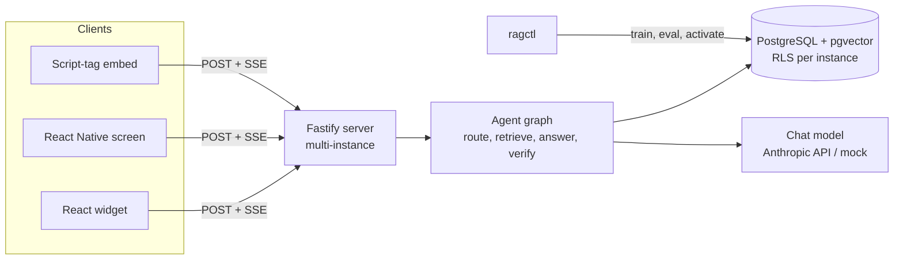

# Agentic RAG Chatbot

A platform for running many small, isolated chatbots that answer from their own documents. Each **instance** has its own knowledge base, persona, access mode (public, authenticated or role-based) and allowed websites. One Node.js server hosts them all; React and React Native components embed them in other apps.

> **Status: early development.** A first end-to-end path works for `public` instances: training, retrieval evaluation, the chat API with SSE and a demo web widget, in mock mode with no API key or in live mode with an Anthropic key. Rows marked "Planned" below are not implemented. See [local setup](docs/local-setup.md) and [the roadmap](#roadmap).

## How it works



- **Train** an instance by pointing `ragctl` at a folder, URL list, sitemap or GitHub docs. Documents are chunked, embedded and stored as a new index version you can activate or roll back.
- **Ask**: the agent graph rewrites the question, runs hybrid search (full-text + vector), drafts a cited answer and checks the citations before it finishes. If the documents don't support an answer, it says so.
- **Isolate**: every row carries its instance, tenant and access tags, and PostgreSQL row-level security filters retrieval inside the database.

## Repository layout

| Path                    | Purpose                                                  | State                                              |
| ----------------------- | -------------------------------------------------------- | -------------------------------------------------- |
| `packages/core`         | Agent graph, retrieval, ingestion, provider interfaces   | In progress; agent graph minimal (ADR 0005 subset) |
| `packages/server`       | PostgreSQL storage, retrieval and the Fastify chat API   | In progress; public mode only                      |
| `packages/client`       | Headless streaming client for web and mobile             | Planned                                            |
| `packages/react`        | React hooks, `<ChatWidget>` and the script-tag bundle    | Planned                                            |
| `packages/react-native` | React Native hooks and chat components                   | Planned                                            |
| `packages/cli`          | `ragctl`: create, train, evaluate and activate instances | Implemented                                        |
| `apps/server`           | Deployable API hosting many instances                    | Implemented for public instances                   |
| `apps/web-demo`         | Demo web app with a minimal chat widget                  | Implemented                                        |
| `apps/mobile-demo`      | Expo demo app                                            | Planned                                            |

## Development

Requires Node 24 and npm.

```bash
npm install
npm run check   # lint, format check, typecheck, tests with coverage, build
```

To run the demo locally, copy `.env.example` to `.env`, fill in the database settings and run `npm run dev` (mock mode, no API key), `npm run dev:ollama` (free local model through Ollama) or `npm run dev:live` (Anthropic API key in `.env`). See [local setup](docs/local-setup.md).

See [docs/development](docs/development) for conventions and the PR workflow, and [docs/adr](docs/adr) for design decisions.

## Roadmap

| Phase | Scope                                                |
| ----- | ---------------------------------------------------- |
| 0     | Tooling, CI, repository standards                    |
| 1     | Architecture decisions                               |
| 2     | Data model, row-level security, training pipeline    |
| 3     | Hybrid retrieval and evaluation harness              |
| 4     | Agent graph                                          |
| 5     | API and access modes                                 |
| 6     | Web client and widget                                |
| 7     | React Native client                                  |
| 8     | Packaging, observability, hosting                    |
| 9–10  | Integration with Aegis AI and ankursingh16.github.io |

## License

[MIT](LICENSE)
