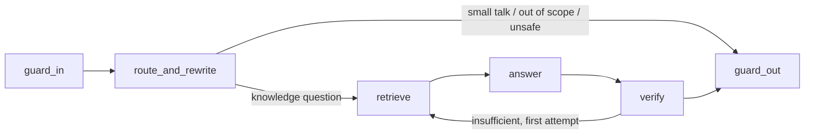

# ADR 0005: Agent graph, streaming and guards

## Status

Accepted

## Context

Answers must be grounded in retrieved documents, cite their sources, refuse when evidence is missing, resist instructions planted in documents, and stream to the user. Cost per turn matters in `public` mode. The design review rejected a first design that streamed tokens before verification, so unverified or injected text could reach the user and be retracted afterwards.

## Options considered

- **Separate router and query-rewrite calls** (up to 5 model calls per turn) versus **one combined call**. The combined call returns the intent and rewritten queries through a tool schema; it cuts latency and cost with no loss for the corpus sizes in scope.
- **Model-based groundedness judge** versus **deterministic verifier** for v1. A judge adds a call per turn and its own failure modes; deterministic checks catch citation errors and unsupported paragraphs cheaply.
- **Stream every token immediately** versus **release paragraph by paragraph after verification**.

## Decision

**Graph:**

- `route_and_rewrite`: one call to the cheaper model. Intent is a Zod-validated enum (`knowledge`, `small_talk`, `out_of_scope`, `unsafe`). It has no influence on `AccessContext`.
- `retrieve`: ADR 0006.
- `answer`: cites only the server-generated citation IDs of retrieved chunks.
- `verify`, deterministic: every citation ID is in the retrieved set, every paragraph cites at least one chunk, and each paragraph clears a lexical-overlap threshold against its cited chunks. One retry with broader retrieval, then `INSUFFICIENT_EVIDENCE`. This is not an entailment check, and the docs say so. A model-based judge is deferred and will be opt-in per instance.

**Guards, deterministic in v1:**

- `guard_in`: message length and character checks; flags known prompt-injection patterns for logging (it does not try to block every phrasing); detects PII for log redaction.
- `guard_out`: blocks output containing a per-request canary string placed in the system prompt, which signals prompt disclosure; enforces `persona.forbiddenTopics` with the instance's refusal text. The `portfolio` instance lists the owner's employment status as a forbidden topic.
- Retrieved text is wrapped as untrusted data in the prompt and never treated as instructions.
- pino redaction removes message text, tokens and PII fields from logs.

**Budgets per turn:** 6 graph steps, 3 model calls, 24,000 input tokens, 1,024 output tokens and a 30-second deadline that includes the retry. One `AbortController` per request, aborted when the client disconnects.

**Streaming.** SSE over a `POST` response. Paragraphs are buffered as they generate. Each paragraph is released only after it passes both the verifier checks and the `guard_out` checks (canary, forbidden topics), so unverified or blocked text never reaches the client. Events:

| Event      | Payload                                                                                       |
| ---------- | --------------------------------------------------------------------------------------------- |
| `meta`     | `{ requestId, conversationId, indexVersion }`                                                 |
| `status`   | `{ node }`                                                                                    |
| `token`    | `{ text }`, verified paragraphs only                                                          |
| `citation` | `{ citationId, title, excerpt, sourceUri }`                                                   |
| `reset`    | `{ reason }`, when the final whole-answer check fails after paragraphs were released          |
| `final`    | `{ state: ANSWERED \| INSUFFICIENT_EVIDENCE \| OUT_OF_SCOPE \| REFUSED, citationIds, usage }` |
| `error`    | `{ code, retryable }`                                                                         |

A `: ping` comment goes out every 15 seconds. Clients must discard released text on `reset`.

## Consequences

- First visible text arrives later than raw token streaming, by roughly one paragraph's generation time.
- Required tests: strings planted in documents never appear in any `token` event; no `token` event ever contains the canary or a forbidden topic; forbidden topics are refused; `reset` handling in both the web and React Native clients; log redaction on pino output.
- The `portfolio` eval set includes employment-status probes that must be refused.
