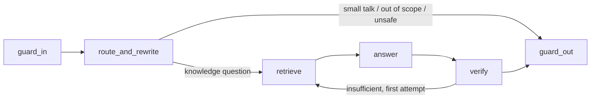

# ADR 0005: Agent graph, streaming and guards

## Status

Accepted

## Context

Answers must be grounded in retrieved documents, cite their sources, refuse when evidence is missing, resist instructions planted in documents, and stream to the user. Cost per turn matters in `public` mode. The design review rejected a first design that streamed tokens before verification, so unverified or injected text could reach the user and be retracted afterwards.

## Options considered

- **Separate router and query-rewrite calls** (up to 5 model calls per turn) versus **one combined call**. The combined call returns the intent and rewritten queries through a tool schema; it cuts latency and cost with no loss for the corpus sizes in scope.
- **Model-based groundedness judge** versus **deterministic verifier** for v1. A judge adds a call per turn and its own failure modes; deterministic checks catch citation errors and unsupported paragraphs cheaply.
- **Stream every token immediately** versus **release paragraph by paragraph after verification**.

## Decision

**Graph:**

- `route_and_rewrite`: one call to the cheaper model. Intent is a Zod-validated enum (`knowledge`, `small_talk`, `out_of_scope`, `unsafe`). It has no influence on `AccessContext`.
- `retrieve`: ADR 0006.
- `answer`: cites only the server-generated citation IDs of retrieved chunks.
- `verify`, deterministic: every citation ID is in the retrieved set, every paragraph cites at least one chunk, and each paragraph clears a lexical-overlap threshold against its cited chunks. One retry with broader retrieval, then `INSUFFICIENT_EVIDENCE`. This is not an entailment check, and the docs say so. A model-based judge is deferred and will be opt-in per instance.

**Guards, deterministic in v1:**

- `guard_in`: message length and character checks; flags known prompt-injection patterns for logging (it does not try to block every phrasing); detects PII for log redaction.
- `guard_out`: blocks output containing a per-request canary string placed in the system prompt, which signals prompt disclosure; enforces `persona.forbiddenTopics` with the instance's refusal text. The `portfolio` instance lists the owner's employment status as a forbidden topic.
- Retrieved text is wrapped as untrusted data in the prompt and never treated as instructions.
- pino redaction removes message text, tokens and PII fields from logs.

**Budgets per turn:** 6 graph steps, 3 model calls, 24,000 input tokens, 1,024 output tokens and a 30-second deadline that includes the retry. One `AbortController` per request, aborted when the client disconnects.

**Streaming.** SSE over a `POST` response. Paragraphs are buffered as they generate. Each paragraph is released only after it passes both the verifier checks and the `guard_out` checks (canary, forbidden topics), so unverified or blocked text never reaches the client. Events:

| Event      | Payload                                                                                       |
| ---------- | --------------------------------------------------------------------------------------------- |
| `meta`     | `{ requestId, conversationId, indexVersion }`                                                 |
| `status`   | `{ node }`                                                                                    |
| `token`    | `{ text }`, verified paragraphs only                                                          |
| `citation` | `{ citationId, title, excerpt, sourceUri }`                                                   |
| `reset`    | `{ reason }`, when the final whole-answer check fails after paragraphs were released          |
| `final`    | `{ state: ANSWERED \| INSUFFICIENT_EVIDENCE \| OUT_OF_SCOPE \| REFUSED, citationIds, usage }` |
| `error`    | `{ code, retryable }`                                                                         |

A `: ping` comment goes out every 15 seconds. Clients must discard released text on `reset`.

## Consequences

- First visible text arrives later than raw token streaming, by roughly one paragraph's generation time.
- Required tests. In place since PR #21 (`packages/core/test/run-chat.test.ts`, `packages/server/test/unit/app.test.ts`, `apps/web-demo/test/ChatWidget.test.tsx`): an instruction planted in a document and obeyed by the model never appears in any `token` event; an answer that copies the system prompt is refused; no `token` event contains a forbidden topic and forbidden topics are refused; `reset` handling in the web client; message text and session tokens are absent from pino output; each model call stays within the per-call input budget. Outstanding (#22): no `token` event contains the canary; `reset` handling in the React Native client.
- The `portfolio` eval set includes employment-status probes that must be refused.

## Amendment (PR #21)

PR #21 implements a minimal graph, mock-first: `guard_in` (length and control characters), `route_and_rewrite` as one forced tool call, hybrid retrieval, `answer`, deterministic `verify` (every citation is a server-issued ID of a retrieved chunk, every paragraph cites one, one retry with 16 chunks, then `INSUFFICIENT_EVIDENCE`), and per-paragraph `guard_out` before release, with `reset` when a later paragraph fails.

`guard_out` checks each paragraph for:

- the instance's `persona.forbiddenTopics`, case-insensitive;
- phrases that appear when a model follows a planted instruction or talks about its instructions ("ignore previous instructions", "system prompt", "you are now", "new instructions:");
- any run of eight words copied from the system prompt or the fixed rules (shorter instruction texts are matched whole).

A blocked paragraph ends the turn with `REFUSED` and the instance's `outOfScope` text. These are lexical checks: a paraphrased disclosure or an obeyed instruction phrased differently passes them. That residual risk is accepted until the controls below land.

Budgets: input is estimated as characters ÷ 4 and capped at 8,000 tokens per call, which keeps three calls within the 24,000-token turn budget. History is trimmed to the newest 2,000 tokens, retrieved chunks are added in rank order until the call budget is reached, and the persona fields have length caps (`systemPrompt` 4,000 characters, `answerStyle` and `outOfScope` 1,000, at most 50 forbidden topics of 200 characters). The six-step budget is not counted separately; the graph has no loop beyond the single retry.

Not implemented yet:

- **Canary.** A per-request canary in the system prompt would change the cached system block on every request and defeat prompt caching (ADR 0008). The alternative to evaluate is a static canary per instance, stored server-side and kept in the cached block.
- **Lexical-overlap threshold in `verify`** between a paragraph and its cited chunks.
- **`guard_in` injection-pattern flagging and PII detection** for log redaction.

Rule: **no instance is exposed publicly until these controls are implemented; tracked in #22.**
