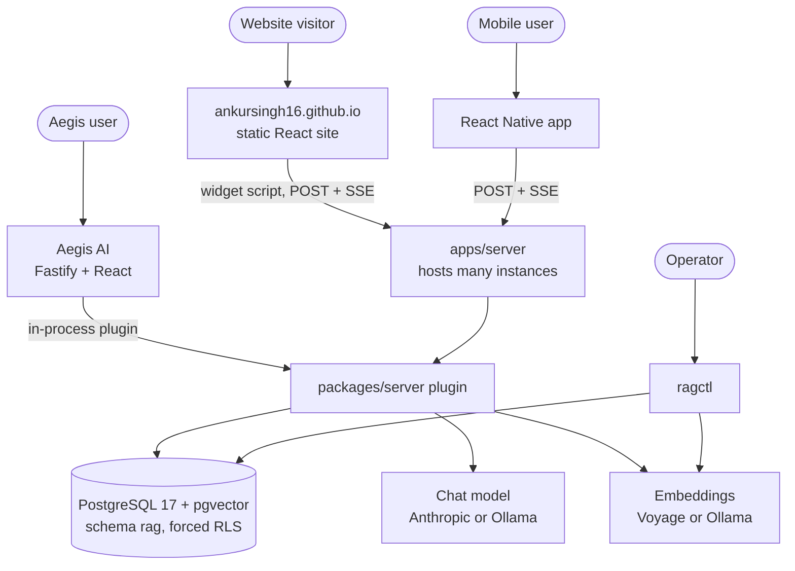
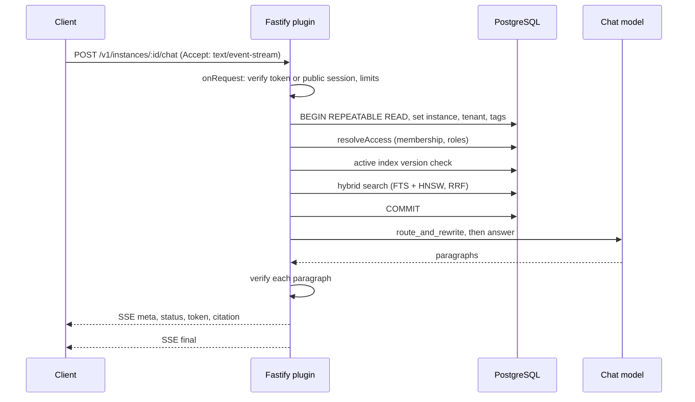
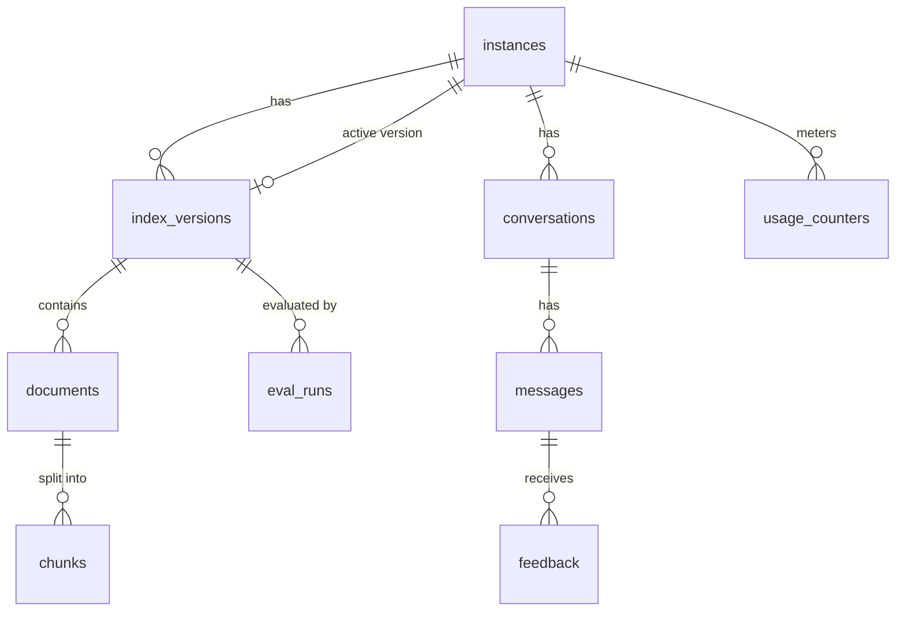

# Architecture overview

One Node.js server hosts many chatbot instances. Each instance answers only from its own documents, under its own access mode. The decisions behind this page are in [docs/adr](../adr/README.md).

> Status: design accepted (phase 1). Implementation starts in phase 2.

## Context

## A chat request

The database transaction closes before any model call, so connections are never held during inference.

## Data model

Corpus rows (`documents`, `chunks`) carry `instance_id`, `tenant_key` and `access_tags`. Forced RLS filters them by the transaction's instance, an exact tenant match, and overlapping tags. Tables, policies, roles and the transaction pattern are described in [Data model](data-model.md).

## Where to read more

| Topic                             | ADR                                                           |
| --------------------------------- | ------------------------------------------------------------- |
| Schema, RLS policies and roles    | [Data model](data-model.md)                                   |
| Packages and boundaries           | [0001](../adr/0001-platform-architecture.md)                  |
| Instances, training, rollback     | [0002](../adr/0002-instances-and-index-versions.md)           |
| Access modes and RLS              | [0003](../adr/0003-access-modes-and-row-level-security.md)    |
| Public sessions and cost controls | [0004](../adr/0004-public-mode-sessions-and-cost-controls.md) |
| Agent graph, guards, streaming    | [0005](../adr/0005-agent-graph-streaming-and-guards.md)       |
| Retrieval and embeddings          | [0006](../adr/0006-retrieval-and-embeddings.md)               |
| Clients, Aegis, website           | [0007](../adr/0007-clients-and-consumer-integrations.md)      |
